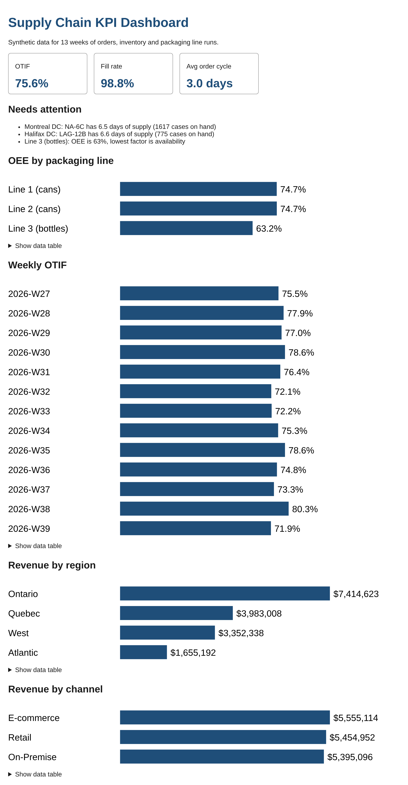

# Supply Chain KPI Dashboard

A Python tool that turns raw order, inventory and packaging line data into the KPIs a beverage supply chain team reviews every week. It loads CSV files into SQLite, calculates each KPI with SQL, flags problems in plain language, and builds an Excel report and an HTML dashboard.

All data is synthetic: 13 weeks of orders for four regions and three sales channels, stock levels at four distribution centres, and daily runs on three packaging lines.



## KPIs

| KPI | Definition |
|---|---|
| OTIF | Share of orders delivered on or before the requested date and in full |
| Fill rate | Cases delivered divided by cases ordered |
| Order cycle time | Average days from order to delivery |
| Days of supply | Cases on hand divided by average daily demand over the last 28 days, per DC and SKU |
| OEE | Availability x performance x quality, per packaging line |
| Revenue | Delivered cases x price, by region and by channel |

The dashboard lists anything under 7 days of supply or under 65% OEE, and names the weakest OEE factor so you know where to look first.

## Excel report

`output/kpi_report.xlsx` has four sheets: Summary, Line OEE, Days of Supply and Revenue. OEE, days of supply and the revenue total use live Excel formulas, so the numbers update if someone edits an input. Values below the thresholds are highlighted with conditional formatting.

## Run it

```bash
pip install -r requirements.txt
python generate_data.py     # writes data/*.csv
python dashboard.py         # writes output/kpi_report.xlsx and output/dashboard.html
python -m pytest tests      # 7 tests
```

## Tests

`tests/test_kpi.py` builds a four-order dataset where every KPI can be checked by hand (for example, OTIF is 50% because only two of the four orders arrived on time and in full). It also checks that the revenue function rejects a column name that is not on its allow list.

## Files

| File | Purpose |
|---|---|
| `generate_data.py` | Creates the synthetic CSV data with a fixed random seed |
| `kpi.py` | Loads data into SQLite and holds one SQL query per KPI |
| `dashboard.py` | Builds the Excel workbook and the HTML dashboard |
| `tests/test_kpi.py` | Unit tests with hand-calculated answers |
